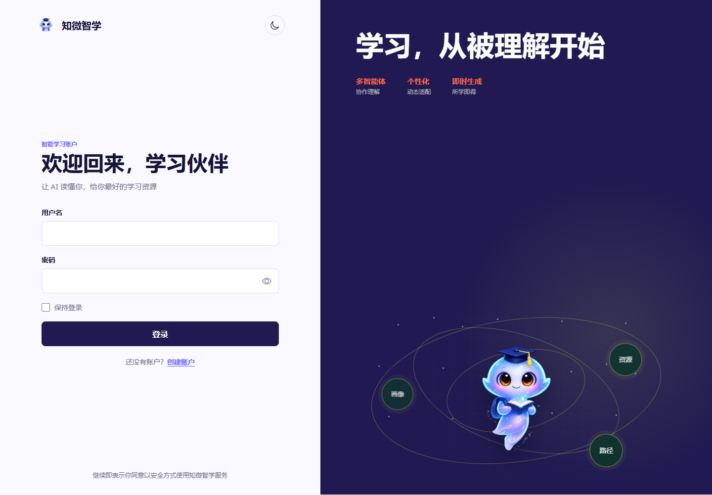

# 知微智学 · 个性化资源生成与学习多智能体系统

一句学习问题，连接画像、资源、路径与辅导。项目面向大学生的个性化学习场景，提供 Vue 工作台与 FastAPI 服务；模型服务和知识库由部署者自行配置。

[项目导览](https://yangwei251003.github.io/zhiwei-ai-learning/) · [部署说明](documents/上线部署说明.md) · [素材来源](documents/素材来源.md) · [MIT](LICENSE)



> **线上体验范围：** GitHub Pages 发布的是无需账号的项目导览，展示真实页面、架构与运行入口。完整注册登录、AI 对话、资源生成、知识库和管理接口需要启动前后端及数据库；导览不会伪造模型回答或访问私人账号。

## 功能与结构

- 学习画像与工作台：组织专业、学习偏好、资源及路径状态。
- 多智能体对话：LangGraph 协调画像、资源、路径和辅导节点，前端处理 SSE 流式内容。
- 学习资源、路径、知识图谱、成就和挑战：对应前端视图与后端接口。
- 知识库：文档加载与检索；可选择本机 Chroma 或自行配置 Supabase pgvector/私有存储。
- 认证与后台：账号服务及知识库管理需要真实后端；浏览器包不携带服务端密钥。

```text
backend/                 FastAPI、Agent、数据模型、迁移、测试
frontend/                Vue 3 + TypeScript 主前端
docs/site/               无需账号的 GitHub Pages 项目导览
documents/               部署与素材来源文档
variants/local-stage7/   本机独立演进实现的清洁源码快照
.github/workflows/       静态导览发布流程
```

## 快速开始：前后端主实现

准备 **Python 3.12**、**Node.js 24 LTS** 与 npm。第一次运行需要联网安装依赖；本地向量模型还可能需要下载模型文件。AI 服务的账号、密钥及使用费用由使用者自行管理。

### 1. 后端

在仓库 `backend` 目录创建并激活虚拟环境。Windows PowerShell：

```powershell
python -m venv .venv
.\.venv\Scripts\Activate.ps1
pip install -r requirements.local.txt
Copy-Item .env.example .env
```

编辑仅保存在本机的 `.env`：设置自己的随机长 `SECRET_KEY`；本机开发可将 `DATABASE_URL` 设为 `sqlite:///./a3_learning.db`、`RAG_BACKEND` 设为 `chroma`，将 `CORS_ORIGINS` 设为实际前端地址（例如 `http://localhost:5173`）。按需填入模型密钥；没有模型配置不应期待在线推理成功。`requirements.local.txt` 包含主依赖与本机 Chroma/Embedding 依赖。

```powershell
alembic upgrade head
uvicorn app.main:app --reload
```

API 文档在 `http://127.0.0.1:8000/docs`。若使用 Supabase，按部署文档设置数据库、私有 Bucket 和迁移，保持 service-role 密钥仅在后端。

### 2. 前端

另开终端，在 `frontend` 目录执行：

```bash
npm ci
npm run dev
```

浏览器打开 Vite 显示的地址，默认开发代理连接本机 `localhost:8000`。若设置 `VITE_API_BASE_URL`，请将其指向你自己的 API 服务；该值只是公开 API 地址，不能放服务端密钥。注册自己的账号后使用完整功能，不提供共享私人账户。

### 3. 检查与构建

```bash
# frontend 目录
npm test
npm run build
npm run preview

# backend 目录，配置隔离测试环境后
pytest
```

前端静态构建不包含 FastAPI、模型或数据库服务；不能将它当作完整的离线 AI 系统。后端测试与真实模型、数据库集成的核验范围请查本轮发布记录；历史文档中的结果只适用于对应版本。

## 本地实现快照与后续计划

`variants/local-stage7` 保存本地另一条开发线的 Vue JavaScript 前端和 stage7 后端源码及原创静态资产。它与主实现结构不同，已保持目录隔离，不能直接相互覆盖。该快照尚未完成独立环境全量回归，启动前需阅读其中 `README-VARIANT.md` 并自行重建配置。

本次公开整理补充根目录 MIT、来源说明、真实截图和静态导览，移除本机运行状态文件并检查当前树与已获取 Git 历史的敏感项。下一步是统一两条实现线的功能对照与回归、优化大型图谱依赖的分包，并继续完善真实课程与用户试用验证。项目不承诺学习效果或模型回答准确率。

## 许可与数据

本项目有权开放的原创代码使用 [MIT](LICENSE)。第三方依赖、字体、实拍素材和模型服务分别适用原协议，见 [THIRD_PARTY_NOTICES.md](THIRD_PARTY_NOTICES.md)。账号、密钥、私人学习资料、上传文档、数据库及运行日志不属于分发内容。

## 原始项目说明

下文保留原始赛道与技术背景，当前运行方式以上述主实现说明及部署文档为准。

> 第十五届“中国软件杯”大学生软件设计大赛 · A3 赛道作品
> 队伍：知微智学 ｜ IP形象：小智析析

## 技术栈

- **前端**: Vue 3 + Vite + Element Plus + Pinia + SSE 流式通信
- **后端**: FastAPI + Python 3.12 + SQLAlchemy + PostgreSQL
- **智能体**: LangGraph 多智能体编排
- **大模型**: 讯飞星火 Spark API（赛道要求）+ DeepSeek/Qwen（可选补充）
- **向量库**: ChromaDB（本地）
- **知识库**: 课程文档 → Embedding → 向量检索

## 项目结构

```
A3-multi-agent-learning/
├── backend/
│   ├── app/
│   │   ├── api/          # API 路由
│   │   ├── core/         # 配置、安全、数据库
│   │   ├── models/       # SQLAlchemy 模型
│   │   ├── agents/       # LangGraph 多智能体
│   │   ├── schemas/      # Pydantic 模型
│   │   └── knowledge_base/  # 知识库工具
│   ├── tests/
│   └── requirements.txt
├── frontend/
│   ├── src/
│   │   ├── views/        # 页面
│   │   ├── components/   # 组件
│   │   ├── api/          # API 请求
│   │   ├── store/        # Pinia 状态
│   │   └── router/       # 路由
│   └── package.json
├── documents/            # 提交文档
└── README.md
```

## 快速开始

```bash
# 后端
cd backend
pip install -r requirements.txt
cp .env.example .env  # 配置讯飞 API Key
uvicorn app.main:app --reload

# 前端
cd frontend
npm install
npm run dev
```
